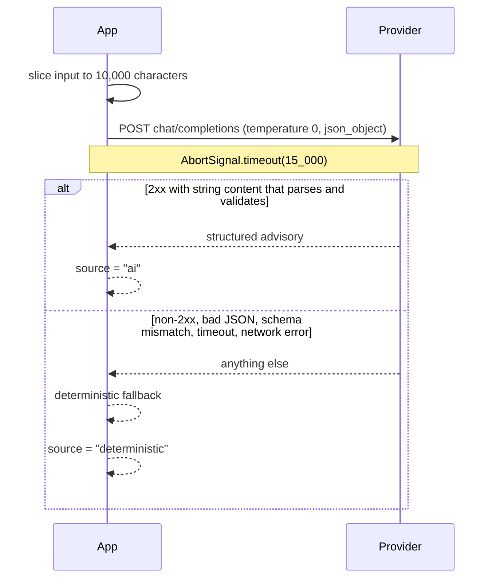
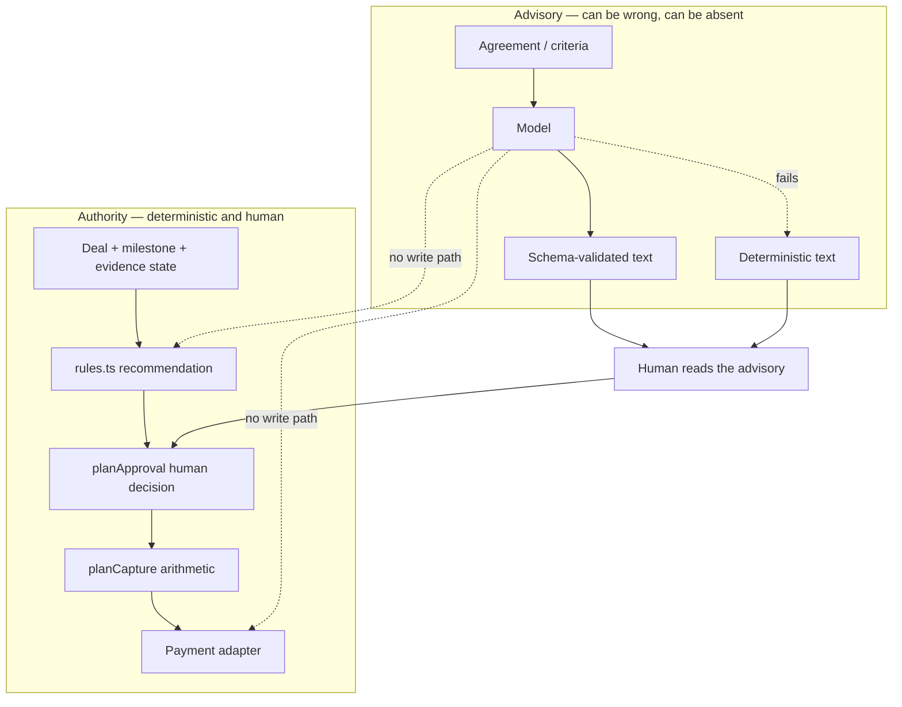

# AI design

The AI in FairHold is an advisory text generator with a strict schema and a deterministic fallback. It has no write path to the database, the payment ledger, the provider adapter or the audit trail.

> AI proposes. Rules decide. Humans approve. PayPal executes. The audit trail records everything.

## Where the model appears

| Capability | Input | Output |
| --- | --- | --- |
| Milestone proposal | Agreement text | `{ title, description, acceptanceCriteria }` |
| Evidence advisory | Milestone acceptance criteria + submitted evidence | `{ summary, matchedCriteria[], concerns[] }` |

Both live in `lib/ai/advisory.ts`. Neither is required for any workflow: with no key configured, the deterministic implementations run and the product behaves identically, minus the prose.

## Configuration

| Variable | Required | Behaviour |
| --- | --- | --- |
| `GEMINI_API_KEY` | No | Must be non-empty and not a `your_` placeholder, or the provider is treated as unconfigured. |
| `GEMINI_MODEL` | No | Same placeholder rule. Sent as `model`. |
| `GEMINI_API_URL` | No | Defaults to `https://generativelanguage.googleapis.com/v1beta/models/{model}:generateContent`. |

`readAdvisoryProviderConfig(env)` returns `null` unless both key and model are usable. Any OpenAI-compatible chat-completions endpoint that supports `response_format: { type: "json_object" }` works with the existing call shape.

## Call shape

- `temperature: 0` — the same input should not produce materially different advice.
- `response_format: { type: "json_object" }` — the model is asked for JSON, but the answer is still parsed and validated locally.
- 15-second abort — an advisory that is slow to arrive is worse than a deterministic one.
- Inputs are truncated to 10,000 characters before they leave the process.

## Prompt boundaries

The system prompt states, in the prompt itself, that the advisory:

- does not authorize a payment,
- does not accept or reject evidence,
- does not change any deal or milestone state,
- is a suggestion for a human to read.

The prompt also instructs the model to return JSON only. Prompt wording is a usability aid, not a security control — the security control is that the caller ignores anything that does not validate and never persists model output as authority.

## Schema validation

| Parser | Rules |
| --- | --- |
| `parseMilestoneProposal` | Requires string `title`, `description`, `acceptanceCriteria`; clamps title to 120, description and criteria to 500. |
| `parseEvidenceAdvisory` | Requires string `summary` (clamped to 1000) and string arrays `matchedCriteria` / `concerns` (≤ 20 items, ≤ 300 characters each). |

Any missing field, wrong type or unparseable body returns `null`, which the caller treats as a provider failure and replaces with the deterministic result. The model can therefore never inject a value that the UI will render outside these bounds.

## Deterministic fallbacks

| Function | Behaviour |
| --- | --- |
| `deterministicMilestoneProposal(agreement)` | Derives a title from delivery keywords in the agreement and uses the first 500 characters as the description. |
| `deterministicEvidenceAdvisory(criteria, evidence)` | Counts submissions, reports whether evidence exists, and lists the criteria as unmatched when nothing has been submitted. |

Both are pure and covered by unit tests, so the "AI unavailable" path is a tested path rather than an untested error branch.

## Authority boundary

Concretely:

- `recommendMilestone` takes `{ deal, milestone, evidence, now }` — no advisory text is an input.
- `planApproval` takes the recommendation and the human's decision — no advisory text is an input.
- `recordApprovalAction` never reads model output.
- The advisory module imports nothing from `lib/data` or `lib/payments`.

## What the model is *not* trusted with

| Risk | Mitigation |
| --- | --- |
| Approving evidence | Approval is a server action gated by role, deal access, the rules engine and the approval planner. |
| Authorizing payment | Only `authorizeDealAction` calls the adapter, and only for a deal in `Ready for Authorization`. |
| Deciding amounts | Amounts come from stored milestones; the client cannot submit one at approval time. |
| Injecting markup or links | Output is limited to plain strings of bounded length; no HTML is rendered from model text. |
| Prompt injection from evidence | Evidence text reaching the model cannot grant authority — the model's answer is advisory text only, and any schema mismatch is discarded. |
| Data exfiltration | Only the agreement or criteria plus evidence text is sent, truncated to 10,000 characters. No session tokens, no payment data, no other deals. |

## Limitations

- **Live provider calls now have call sites, but live verification is still pending in this environment.** No `GEMINI_API_KEY` was configured during verification; the deterministic fallbacks are what the test suite exercises. Do not describe live AI as verified until a real request has been made and its response validated.
- The advisory is single-shot: no retries, no streaming, no conversation memory.
- The model never sees the ledger or the provider state, so it cannot comment on payment status.
- There is no evaluation harness or golden dataset. If the prompts change, only schema validation and the deterministic fallback protect the product.
