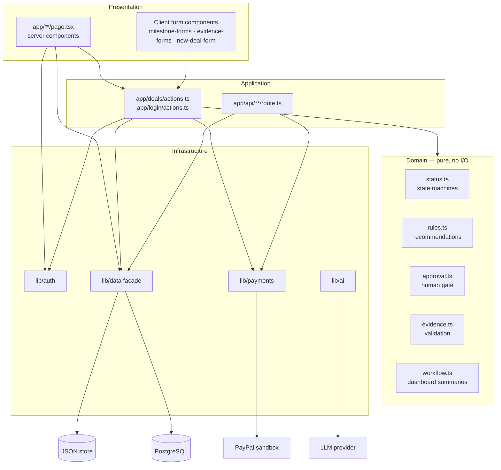
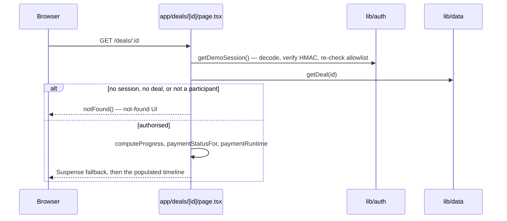
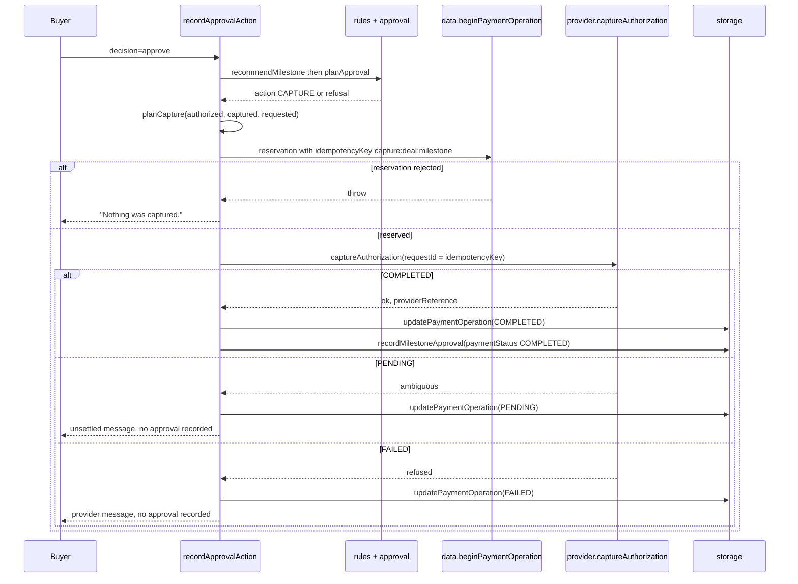

# Architecture

FairHold is a single Next.js application. Server components read state, server actions mutate it, and two HTTP routes exist for machine-to-machine traffic (evidence download and the PayPal webhook).

## Layering

The dependency rule is one-directional: domain modules import only domain types; infrastructure modules may import domain; presentation imports both. No domain module performs I/O, which is why every rule is testable without a server, a database or a network.

## Directory map

| Path | Contents |
| --- | --- |
| `app/page.tsx` | Landing page: positioning, workflow, boundaries. |
| `app/login/` | Demo sign-in page and `loginAction` / `logoutAction`. |
| `app/dashboard/` | Role-framed workspace with Suspense skeleton, error and loading boundaries. |
| `app/deals/new/` | Deal creation form and action. |
| `app/deals/[id]/` | Deal detail: timeline, evidence, approvals, payment status. |
| `app/api/evidence/[dealId]/[evidenceId]/route.ts` | Authorised evidence download. |
| `app/api/paypal/webhook/route.ts` | Webhook entry point. |
| `app/deals/actions.ts` | Every deal mutation (651 lines, ten exported actions). |
| `lib/domain/` | State machines, rules, approval gate, evidence validation, formatting, dashboard summaries. |
| `lib/data/` | `index.ts` facade, `deals.ts` + `store.ts` (JSON), `postgres/` (SQL), `payment-operations.ts`, `storage.ts`. |
| `lib/payments/` | `provider.ts` contract, `runtime.ts` selection, `demo.ts`, `paypal.ts`, `capture-state.ts`, `transport.ts`, `webhook-endpoint.ts`. |
| `lib/ai/advisory.ts` | Advisory calls, schema validation, deterministic fallbacks. |
| `lib/auth/` | `session-token.ts` (HMAC), `session.ts` (cookie + `canAccessDeal`), `demo-allowlist.ts`. |
| `migrations/` | `0001_initial.sql` … `0004_payment_operations.sql`. |
| `tests/` | `evidence-lifecycle.spec.ts` — three journeys run across three device profiles. |
| `scripts/` | `demo-reset.mjs`, `db-migrate.mjs`, `db-import-json.mjs`. |

## Request flows

### Read path — deal detail

The access check happens **before** the shell is streamed. An earlier build returned a blank streamed page when `notFound()` fired inside a Suspense child; the guard is now synchronous in the page body (see `DECISIONS.md`).

### Write path — booking a capture

The reservation exists so two concurrent approvals, or one double-submitted form, cannot spend the same authorization twice. The approval record is written **after** the ledger update, so an approval never claims a payment that did not happen.

## Design decisions

| Decision | Rationale | Trade-off |
| --- | --- | --- |
| Deterministic rules instead of model judgement | Money decisions must be reproducible and explainable. | The rule set is conservative and sometimes lands on `HOLD` where a human could obviously proceed. |
| One data facade, two backends | The demo must run with zero infrastructure; production must be transactional. | Both implementations must be kept signature-compatible, which is enforced by the shared `lib/data/index.ts` bindings. |
| Reservation before provider call | Atomicity without a distributed transaction. | A crash between reservation and update leaves a `RESERVED` row that needs manual reconciliation — but never a double spend. |
| Ambiguity is `PENDING`, not failure | A timeout is not evidence that money did not move. | Some captures stay unresolved until an operator checks the provider. |
| Money in integer cents | No floating point anywhere in the payment path. | Formatting must happen at the edges (`lib/domain/format.ts`). |
| CSS-only motion | No animation runtime, no hydration cost, trivial reduced-motion support. | No timeline-driven choreography; scroll effects are CSS-only. |
| Server actions instead of a REST API for mutations | Fewer moving parts, no client-side auth duplication. | Not consumable by third-party clients; the API surface is the two routes below. |
| Webhook quarantines commit and return 200 | Retrying an event that can never match would loop forever. | A quarantined event needs an operator to read the reason and act. |

## Runtime modes

| Mode | Selected when | Payment adapter | Persistence |
| --- | --- | --- | --- |
| Local demo | `DATABASE_URL` unset, `PAYPAL_ENV` not `sandbox` | `DemoPaymentProvider` | `.data/fairhold.json` |
| Local sandbox | `PAYPAL_ENV=sandbox` with credentials, `DATABASE_URL` set | `PayPalSandboxProvider` | PostgreSQL |
| Degraded | PayPal credentials present, `DATABASE_URL` unset | `DemoPaymentProvider`, with `sandboxRequiresPostgres` reported | JSON |
| Production | `DATABASE_URL` + `FAIRHOLD_SESSION_SECRET` + allowlists | As configured | PostgreSQL |

The degraded mode is deliberate: real provider calls require durable accounting, so credentials without a database never silently produce real-money operations.

## Evidence storage

Uploads are validated in the domain layer (extension allowlist, 3 MB cap, magic-number sniffing), then written through `writeEvidenceFile` with a sanitised name, and the stored path is recorded on the evidence row. Downloads go through the route handler, which re-derives authorisation from the session and the deal, then pins `Content-Type` to the sniffed type and sets `X-Content-Type-Options: nosniff` on an attachment response.

## Audit history

`audit_events` rows are appended by the data layer on deal creation, milestone creation/update/status change, evidence submission and review, authorization, approval and payment outcomes. The UI renders only recorded events, newest first. There is no client-side event synthesis: an empty history renders as empty.

## Boundaries worth restating

- The AI module has no write path to the database, the ledger or the provider.
- `allowedManualDealTransitions` removes `Authorized`, so a form cannot forge payment state.
- The webhook reconciles provider facts against records a human already created; it cannot create an approval.
- Live PayPal credentials are refused; only `PAYPAL_ENV=sandbox` activates the real adapter.
