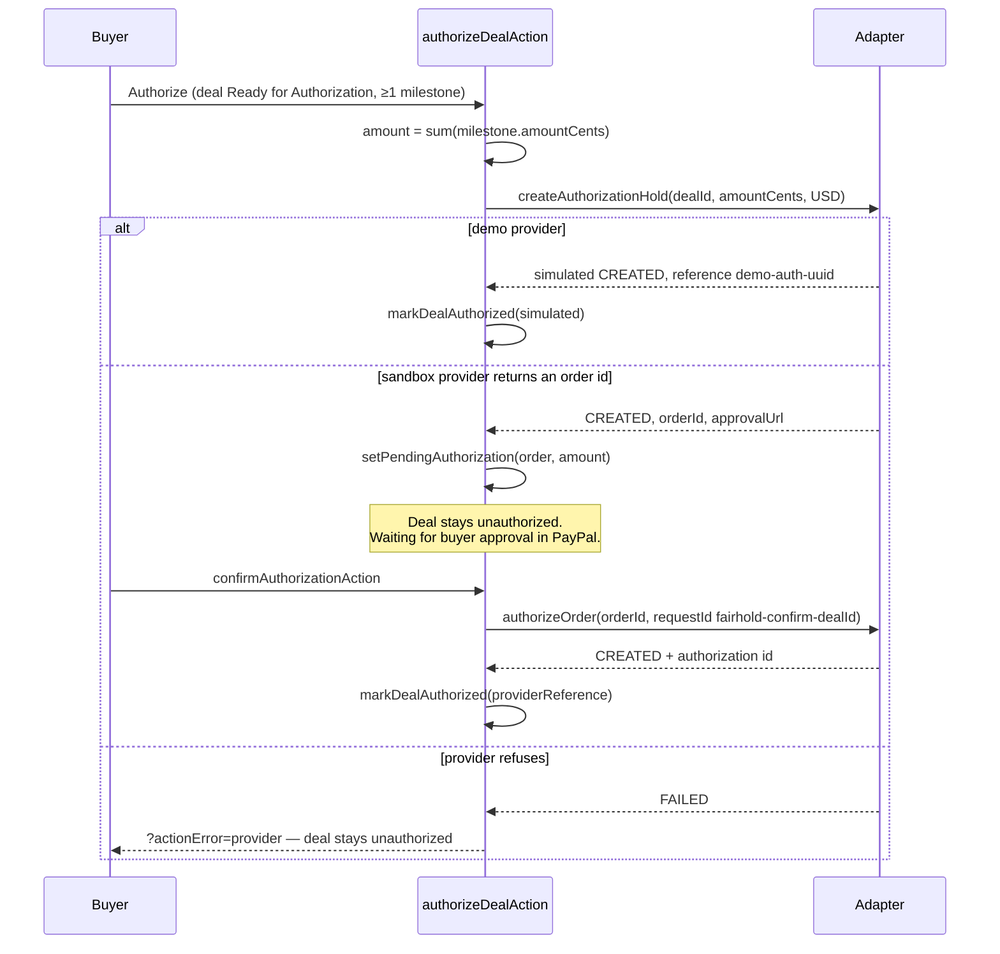
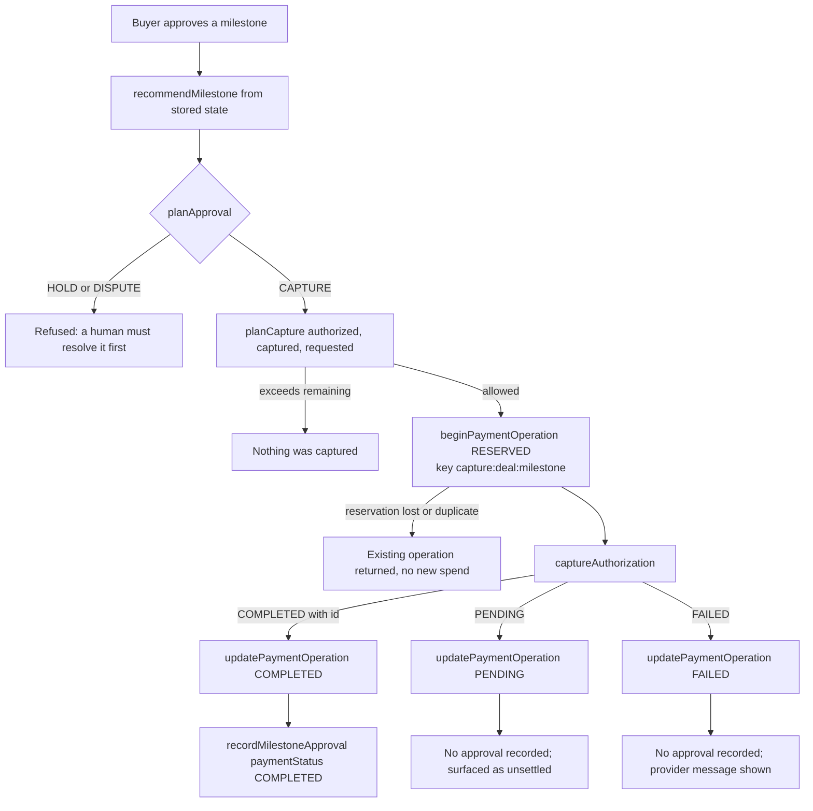
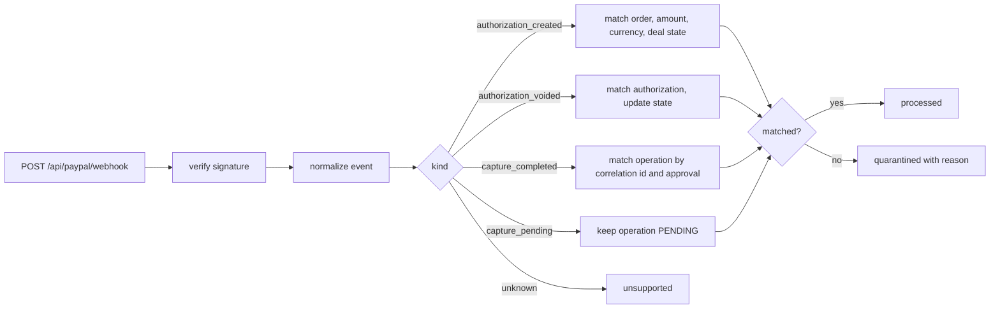

# Payment flow

FairHold coordinates a PayPal **authorization hold** per deal and a **capture** per approved milestone. Nothing in this document describes escrow, settlement guarantees or refunds, because FairHold implements none of them.

> A hold is a hold. An authorization reserves an amount on the buyer's funding source for a limited period (PayPal documents 29 days for the standard authorization). It is not money in FairHold's possession, and it is not protection against a seller who never delivers.

## Two adapters, one contract

`lib/payments/provider.ts` defines the interface every adapter implements:

```ts
interface PaymentProvider {
  readonly name: string;
  readonly mode: "demo" | "sandbox" | "live";
  createAuthorizationHold(req: AuthorizationRequest): Promise<AuthorizationResult>;
  authorizeOrder(req: AuthorizeOrderRequest): Promise<AuthorizeOrderResult>;
  captureAuthorization(req: CaptureRequest): Promise<PaymentOperationResult>;
  voidAuthorization(req: VoidRequest): Promise<PaymentOperationResult>;
}
```

| Adapter | Mode | Network | Used when |
| --- | --- | --- | --- |
| `DemoPaymentProvider` | `demo` | none | No PayPal credentials, or credentials without PostgreSQL |
| `PayPalSandboxProvider` | `sandbox` | PayPal sandbox REST | `PAYPAL_ENV=sandbox` + ID + secret + PostgreSQL |

`readPayPalConfig` refuses to activate the sandbox adapter unless `PAYPAL_ENV` is exactly `sandbox` and neither credential looks like a placeholder (`/^your_/i`). Live mode is not reachable: there is no code path that constructs a live adapter.

`paymentRuntime()` chooses once, before an operation starts. If credentials exist but `DATABASE_URL` is unset, it returns the demo provider **and** reports `sandboxRequiresPostgres: true` — real operations need durable accounting, so they are unavailable rather than silently simulated.

## Outcome semantics

| Status | Meaning | `ok` |
| --- | --- | --- |
| `COMPLETED` | Provider explicitly confirmed settlement **and** returned a usable reference. | `true` |
| `VOIDED` | The hold was released. This is not a refund. | `true` |
| `PENDING` | Ambiguous: timeout, explicit pending, or a success response without a reference. Money may or may not have moved. | `false` |
| `FAILED` | Definitive refusal. No money moved. | `false` |

A `2xx` alone is never treated as success. `PayPalSandboxProvider.captureAuthorization` requires `status === "COMPLETED"` **and** a non-empty capture `id` before returning `COMPLETED`; a `COMPLETED` response with no id is downgraded to `PENDING`.

## Authorization



The pending order is a record of intent, not proof. Only the signed result of `authorizeOrder` marks the deal `Authorized`, and `Authorized` is unreachable from a form because `allowedManualDealTransitions` removes it.

## Capture



`planCapture(authorized, captured, requested)` enforces four things: the authorization is a positive safe integer, something remains, the request is positive, and the request does not exceed the remainder. It also returns `finalCapture`, which is sent to PayPal as `final_capture` when the request equals the remainder — letting PayPal release the rest of the hold.

### Remaining authorization and partial capture

Because each milestone has its own amount and the ledger tracks `completed + allocated`, a second capture is checked against what is actually left. This means:

- Partial capture is supported at milestone granularity, not as an arbitrary split of a milestone.
- A capture that exceeds the remainder is refused **before** any provider call.
- Outstanding `RESERVED`/`PENDING` operations count against the remainder, so two approvals cannot each spend the same money.
- The last capture sets `final_capture: true`, which is the only way the remainder is released.

## Void

`recordApprovalAction` plans `VOID` when the rules recommend it (deal or milestone cancelled) and the human approves. `voidAuthorization` requires a reference, posts to `/v2/payments/authorizations/{id}/void` with request id `fairhold-void-{milestoneId}`, and treats a timeout or network failure as `PENDING`.

Voiding releases the hold. It is not a refund, and FairHold does not implement one: a capture that has completed has moved money, and reversing it is out of scope.

## Idempotency

| Layer | Mechanism |
| --- | --- |
| HTTP | `PayPal-Request-Id` set from the idempotency key (`capture:{dealId}:{milestoneId}`, `void:{dealId}:{milestoneId}`, `fairhold-confirm-{dealId}`), so a retried request is deduplicated by PayPal. |
| Ledger | `payment_operations.idempotency_key` is unique; `beginPaymentOperation` returns the existing row instead of creating a second one. |
| Provider reference | `payment_operations(provider_name, provider_reference)` is unique, so a provider fact cannot be booked twice. |
| Demo adapter | The simulated reference is derived from the request id, so a retried simulated capture is stable. |
| Webhook | Event ids are recorded; a redelivery returns `duplicate` and changes nothing. |

`updatePaymentOperation` is stateful in a deliberate way: it is a no-op on an already `COMPLETED` or `VOIDED` operation, and it refuses to move a `FAILED` operation back to a non-failed status. A late arrival cannot resurrect a failed payment.

## Ambiguous outcomes

Timeouts and network failures are the hard case, and the code treats them conservatively:

- Transport timeout → `PENDING` with "Capture outcome is unknown (timeout). Do not retry blindly — reconcile against PayPal first."
- Network error before a response → `PENDING` with "Preserve the reservation and reconcile before retrying."
- Non-`2xx` → `FAILED` (the provider answered).
- `2xx` without a usable reference → `PENDING`.

A `PENDING` capture stays reserved. The UI shows it as unsettled rather than failed. Reconciliation is a manual operator step: compare the reserved/`PENDING` operation against the PayPal transaction report and then record the real outcome. There is no automatic reconciliation job in this build.

## Webhooks

Webhooks reconcile provider-reported facts with records a human already created. They never create an approval and never capture money.



Every capture event must match an existing human approval, the expected amount and currency, the stored authorization and the reserved operation. Anything else is quarantined — for example `no matching human approval`, `capture amount mismatch`, `pending capture correlation mismatch`, `capture id belongs to conflicting payment operation`. Quarantine is committed and answered `2xx` so PayPal stops retrying a fact FairHold cannot use.

## Sandbox verification status

**Not verified in this environment.** No PayPal sandbox credentials or webhook id were configured, so no live authorization, capture, void or webhook was executed. What *is* verified:

- The full lifecycle through the demo adapter, asserted by the Playwright journey (authorize → capture → duplicate-payment attempt blocked).
- Unit and integration coverage of the adapter logic, capture planning, reservation arithmetic, webhook signature decision table and quarantine reasons.
- The webhook HTTP contract (status codes, header requirements, body limits, retry semantics) exercised through the endpoint with injected dependencies.

To run a real sandbox verification, see the configuration in [DEPLOYMENT.md](./DEPLOYMENT.md) and the checklist in [RELEASE_CHECKLIST.md](./RELEASE_CHECKLIST.md). Do not record the outcome as verified until a sandbox transaction report has been compared against the ledger.
