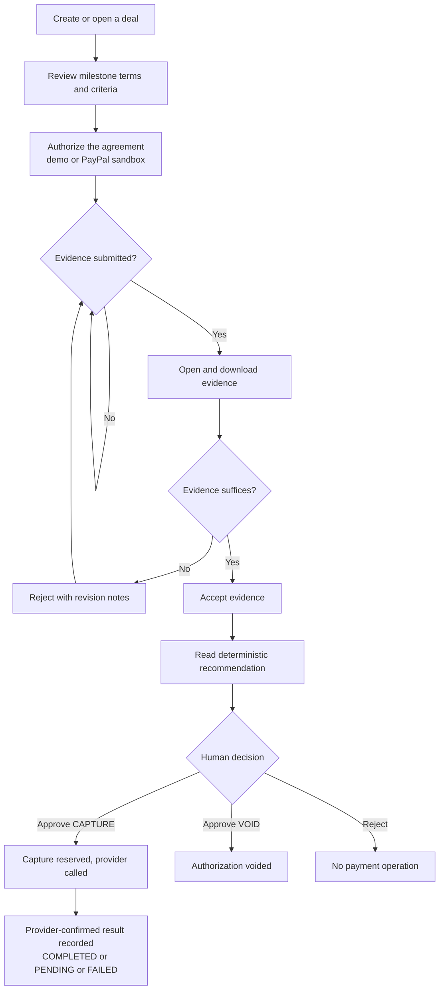
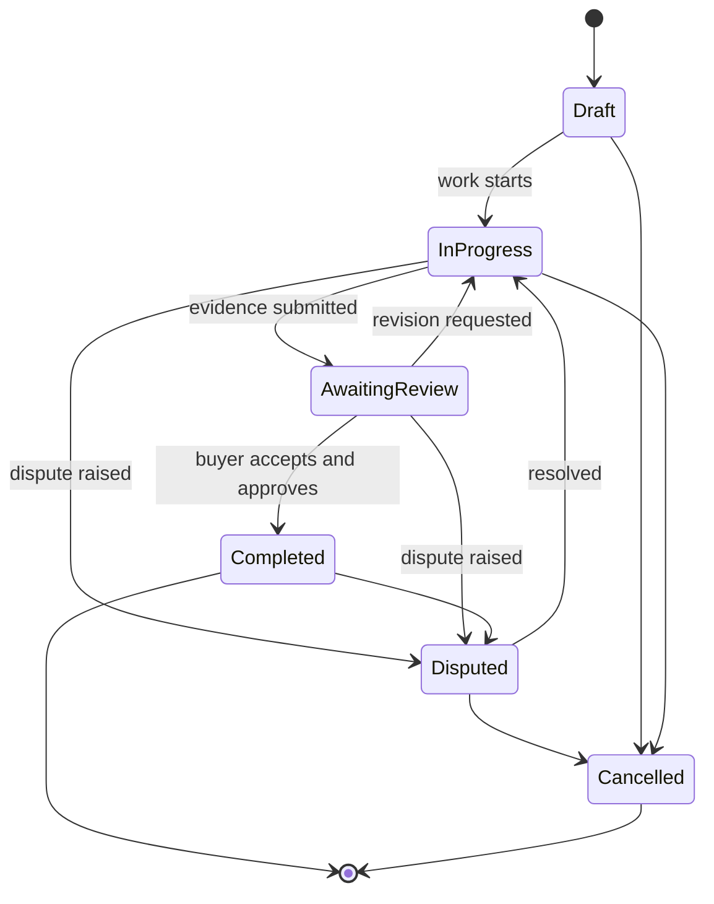
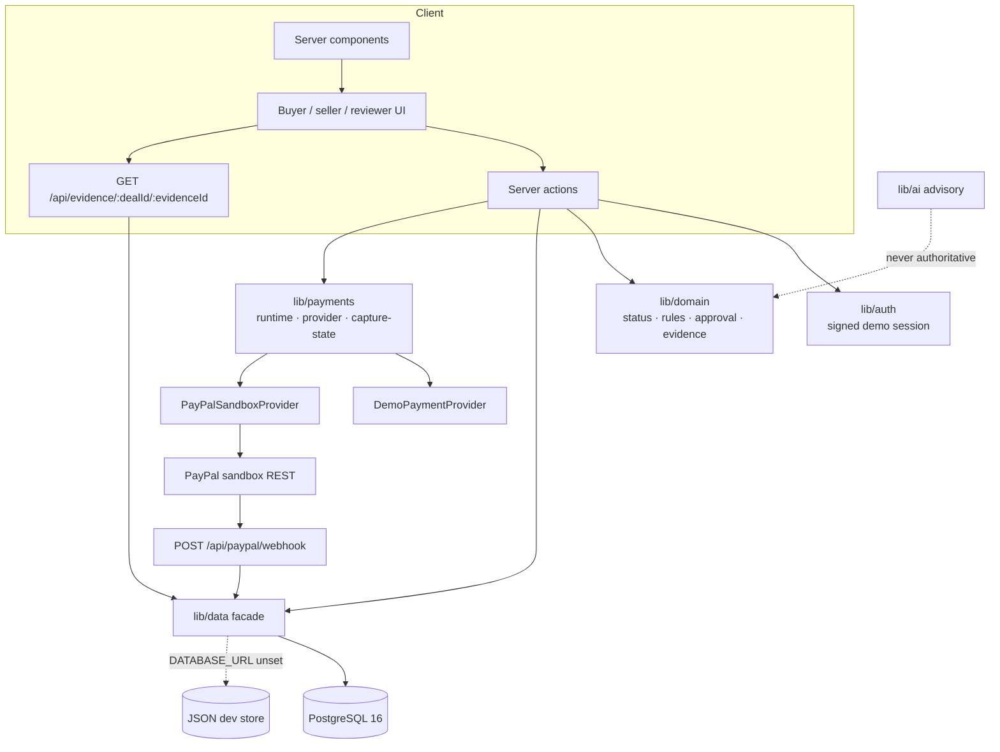
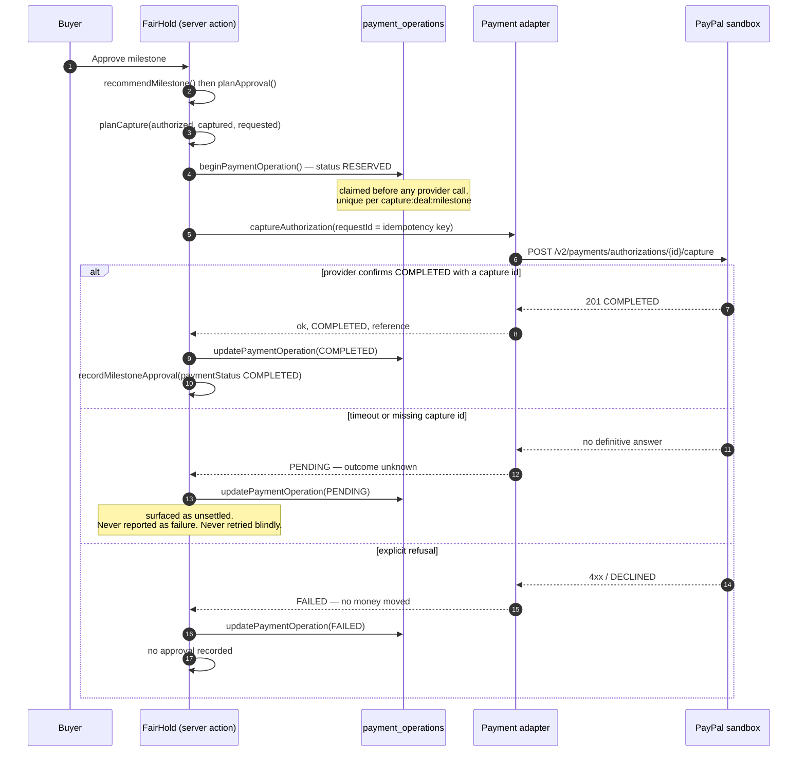
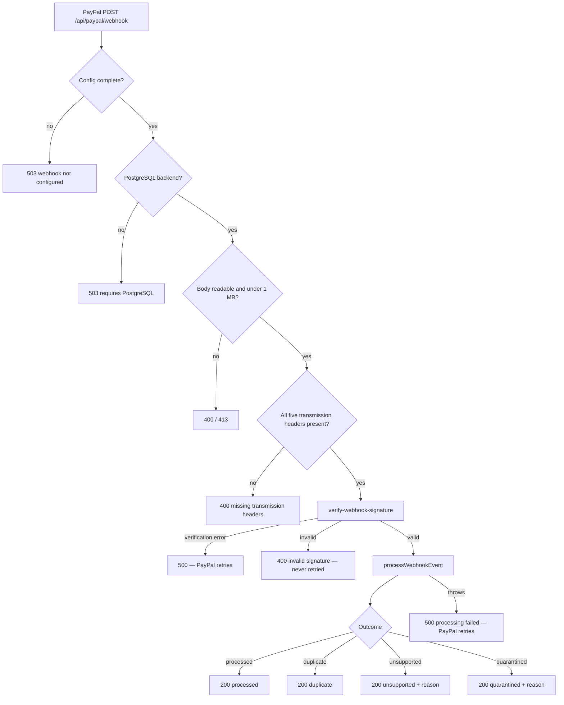
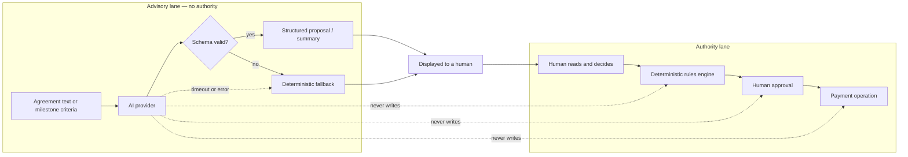
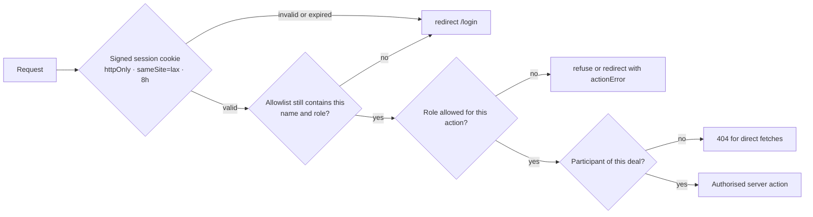

<div align="center">


# FairHold

**Milestone-based payment coordination for buyers and sellers.**

Work moves forward. Payments move with proof.

[](https://nextjs.org)
[](https://react.dev)
[](https://www.typescriptlang.org)
[](https://www.postgresql.org)
[](#development-and-testing)
[](#development-and-testing)
[](#milestone-and-payment-lifecycle)

</div>

---

## Live demo

**Open it now → https://fairhold-beta.vercel.app**

No account, no install, no API key. Two ways in:

| Path | What you get |
| --- | --- |
| **Guided demo** — [`/demo`](https://fairhold-beta.vercel.app/demo) | The full lifecycle against a fixed scenario, running in your browser with simulated payments. No server writes, no provider calls. |
| **Full roles** — [`/login`](https://fairhold-beta.vercel.app/login) | Sign in as `Alex Buyer`, `Jamie Seller` or `Morgan Reviewer` and drive real server-side actions. |

> **Payments are simulated.** No PayPal Live account is configured and no real money moves. Every payment control in the interface is labelled `SIMULATED`, and the provider is the in-app demo adapter — not PayPal. See [What FairHold is not](#what-fairhold-is-not).

**The five-minute judge path** is written out in [DEMO_GUIDE.md](./DEMO_GUIDE.md), and the full twelve-step buyer → seller → reviewer journey is in [DEMO_RECORDING_GUIDE.md](./DEMO_RECORDING_GUIDE.md).

---

## The philosophy

> **AI proposes. Humans decide. Rules enforce. PayPal executes. The audit trail records.**

Every design decision in FairHold follows that ordering. The language model can suggest a milestone breakdown or summarise submitted evidence, but it has no authority. A deterministic rules engine reads the deal state and recommends `CAPTURE`, `VOID`, `HOLD` or `DISPUTE`. A human buyer (or a reviewer explicitly granted that deal) makes the decision. Only then does the payment adapter speak to PayPal. Every step is written to an append-only audit trail.

## The problem

Freelance and small-agency work is paid against trust rather than proof. Buyers hesitate to release money before delivery; sellers hesitate to deliver before payment. The usual workarounds — invoicing after the fact, informal "50% upfront" splits, screenshot-based promises — leave both sides without a shared record of what was agreed, what evidence was submitted, who approved it and what the payment state actually is.

## What FairHold does

FairHold makes the milestone itself the unit of coordination:

1. A **deal** is created between a buyer and a seller with an agreed total.
2. The work is split into **milestones**, each with an amount, due date and written acceptance criteria.
3. The parties **authorize the agreement** — in the demo provider, or against a PayPal sandbox authorization hold.
4. The seller **submits evidence** (file, URL or note) against a milestone.
5. The buyer **reviews** the evidence, accepts it or requests a revision.
6. A **deterministic recommendation** is computed from the deal state.
7. A **human approves** the milestone; that approval is what plans a payment operation.
8. The **payment adapter** performs the PayPal capture (full or partial) and records the provider-confirmed result.
9. The **activity trail** keeps the full history, in order, including rejections and revisions.

## What FairHold is not

| Not this | Why it matters |
| --- | --- |
| **Escrow** | A PayPal authorization is a temporary hold on funds. FairHold never calls it escrow, settlement or guaranteed protection. |
| **An AI decision-maker** | The model is advisory only. It cannot approve evidence, authorize payment or capture funds. |
| **Production identity verification** | The current build uses a signed demo session plus server-side allowlists. That is not KYC and not multi-tenant auth. |
| **A refund system** | Voiding releases an authorization hold. Refunds are intentionally not modelled. |
| **A live-money product** | The real adapter is restricted to the PayPal *sandbox*. Live credentials are refused by configuration. |

---

## Key features

- **Role-aware workspaces** — distinct buyer and seller dashboards built around the actions each role actually owns, plus per-deal reviewer grants.
- **Milestone timeline** — the signature screen: every milestone state, evidence submission, review decision, revision and payment outcome on one timeline.
- **Evidence with real validation** — extension allowlist, 3 MB cap, magic-number type sniffing, sanitised filenames, authorised download route with `nosniff`.
- **Deterministic decision engine** — pure functions produce recommendations with reason codes and a human-readable explanation.
- **Human approval gate** — approving a `HOLD` or `DISPUTE` recommendation is refused; only `CAPTURE` and `VOID` can be approved.
- **Partial capture** — a milestone can capture less than the authorized amount; the remainder stays authorized until voided or expired at the provider.
- **Idempotent payment operations** — reservations are claimed before the provider call, keyed by `capture:<dealId>:<milestoneId>`, so a double submit cannot double-capture.
- **Honest ambiguity handling** — a timeout is recorded as `PENDING`, never as failure, and is surfaced to the user as an unsettled outcome to reconcile.
- **Fail-closed webhooks** — signature verification, duplicate suppression and a durable inbox with sanitised quarantine reasons.
- **Audit trail** — append-only events with actor, timestamp and payload; the UI renders recorded history only.
- **Reduced-motion-safe motion system** — CSS-only reveal choreography with one owner per animated property.
- **Public guided demo** — `/demo` runs the same deterministic rules in the browser against a fixed scenario, with simulated payments, no server writes and no provider calls.
- **Exact money** — every amount is an integer number of cents; typed amounts are parsed straight to cents, so no float rounding can reach the ledger.
- **Search, filters and honest empty states** — the dashboard narrows by text or status, says how many records match, and offers a clear path when nothing matches.
- **Fee transparency** — the deal page states that no FairHold platform fee is implemented in this build and that provider merchant fees sit outside the ledger.
- **Launch video** — a 100-second HyperFrames composition (source, storyboard, captions and MP4) in [`videos/fairhold-launch/`](./videos/fairhold-launch/).

---

## How FairHold works



### Milestone lifecycle



Deal states follow the same shape, with one deliberate exception: `Authorized` can never be set by hand. It is only entered by the payment adapter after a provider-confirmed authorization (`allowedManualDealTransitions` filters it out).

## Judge demo walkthrough

The fastest way to evaluate FairHold — two paths, both using only simulated payments:

**Path A — no sign-in (2 minutes).** Start the app, open [`/demo`](./DEMO_GUIDE.md), and walk the fixed scenario end to end: agreement, evidence, revision, acceptance, approval, simulated capture. The money summary updates as the deterministic rules fire. Every simulated action is labelled as simulated in the UI.

**Path B — full roles (5 minutes).** Follow [DEMO_GUIDE.md](./DEMO_GUIDE.md):

1. Sign in as `Jamie Seller` on `/login`, submit evidence against a milestone.
2. Sign out, sign in as `Alex Buyer`, open the deal, request a revision with notes.
3. Switch back to the seller, resubmit; back to the buyer, accept.
4. Read the deterministic recommendation, approve it, and watch the capture operation move through `RESERVED → COMPLETED` (simulated).
5. Inspect the **audit trail** on the deal page — every step above appears as an append-only event with actor and timestamp.

**What to inspect in the code:**

| Claim | Where to verify |
| --- | --- |
| AI has no write authority | `lib/ai/` — advisory calls only; no import into approval paths |
| Rules are deterministic | `lib/domain/approval.ts`, recommendation rules + `lib/domain/*.test.ts` |
| Humans approve, server-side | `app/deals/actions.ts` — every payment path calls `planApproval()` first |
| Double submits cannot double-capture | `lib/payments/` — idempotency reservation keyed `capture:<dealId>:<milestoneId>` |
| Webhooks verify signatures | `app/api/paypal/webhook/` — fail-closed verification, durable inbox |
| History is append-only | `lib/data/` — `audit_events` writes, no update/delete paths |

For a spoken script with timing beats: [DEMO_SCRIPT_3MIN.md](./DEMO_SCRIPT_3MIN.md).

---

## User roles and permissions

| Capability | Buyer | Seller | Reviewer (per-deal grant) |
| --- | :-: | :-: | :-: |
| Create a deal, set milestones and criteria | ✅ | ➖ (existing deals) | ❌ |
| Authorize the agreement | ✅ | ❌ | ❌ |
| Submit evidence | ❌ | ✅ | ❌ |
| Review evidence (accept / request revision) | ✅ | ❌ | ✅ when granted |
| Read deterministic recommendation | ✅ | ❌ | ✅ when granted |
| Approve or reject a recommendation | ✅ | ❌ | ✅ when granted |
| View audit trail and payment state | ✅ (own deals) | ✅ (own deals) | ✅ (granted deals) |
| Approve outside a granted deal | ❌ | ❌ | ❌ — enforced server-side, fails closed |

Notes:

- Reviewers receive no ambient access. `FAIRHOLD_REVIEWER_DEALS` grants `reviewer-name:deal-id` pairs; without a matching grant the server refuses review and approval actions for that deal.
- Allowlists are re-checked on every session read, so removing a name invalidates live cookies.
- Direct fetches for resources the caller does not own return `404`, not `403`, so routes do not leak existence.

---

## Architecture and technology stack



| Layer | Choice | Why |
| --- | --- | --- |
| Framework | Next.js 16.4.3 (App Router, Turbopack, Cache Components) | Server actions keep state changes on the server; `connection()` marks dynamic reads explicitly. |
| UI | React 19.3 + Tailwind CSS 4 | CSS-first tokens, small runtime, no component library to fight. |
| Language | TypeScript 5, strict | Domain rules are shared by server, tests and UI. |
| Data | PostgreSQL 16 (`pg`) with a JSON dev store | One data facade, two interchangeable backends with identical signatures. |
| Payments | PayPal sandbox REST adapter | Same contract shape as the demo provider, so UI logic never branches on provider. |
| Tests | `node:test` + Playwright | Native runner for units and PG integration; real browser journeys for the lifecycle. |
| Motion | CSS transitions and keyframes | One owner per property, reduced-motion safe, zero animation runtime. |

| Path | Responsibility |
| --- | --- |
| `app/` | Routes, layouts, server actions, error/loading/not-found boundaries. |
| `components/` | Status badge, progress bar, session navigation — the shared visual vocabulary. |
| `lib/auth/` | HMAC-signed demo session token, allowlists, per-deal reviewer grants. |
| `lib/domain/` | Pure state machine, recommendation rules, approval planning, evidence validation, formatting. |
| `lib/data/` | Backend selection plus identical JSON and PostgreSQL implementations. |
| `lib/payments/` | Provider contract, adapter selection, capture planning, HTTP transport, webhook endpoint. |
| `lib/ai/` | Advisory calls with strict schema validation and deterministic fallbacks. |
| `migrations/` | Eight forward-only SQL migrations, checks and indexes. |
| `tests/` | Playwright lifecycle, access-control, onboarding and deal-creation journeys. |

Full detail: [ARCHITECTURE.md](./ARCHITECTURE.md).

---

## Milestone and payment lifecycle

### Authorization, capture, partial capture and void



Payment-safety design, stated precisely:

- **Authorization is not a capture.** An authorization places a temporary hold. Money moves only when the provider confirms a capture. FairHold records authorization and capture as separate provider facts with their own rows.
- **Partial capture.** `planCapture` computes the remaining authorized amount (`remainingCents`) and refuses any capture that exceeds it. A capture strictly less than the remainder is a partial capture: the captured portion settles (at the provider), and the **remaining authorization** stays open until it is voided or expires at the provider. A capture equal to the remainder is flagged `finalCapture`.
- **Void.** Voiding releases whatever remains of the authorization without moving money. It is a valid human decision alongside capture — the approval gate treats `CAPTURE` and `VOID` as approvable, and `HOLD` / `DISPUTE` as refused.
- **Idempotency.** Each capture attempt claims a `payment_operations` reservation keyed `capture:<dealId>:<milestoneId>` *before* any provider call. A double-clicked approval finds the reservation taken and does not issue a second provider call.
- **Concurrency.** Amount checks (remaining authorization) run against server-side state inside the same operation that claims the reservation; concurrent requests cannot exceed the authorized total.
- **Ambiguity is honest.** A timeout or missing capture id is recorded as `PENDING` and shown to the operator as an unsettled outcome. It is never reported as failure and never blindly retried.

### Webhook reconciliation



Webhooks **reconcile provider events; they do not create human approval.** The webhook path verifies the signature against PayPal, suppresses duplicates through a durable inbox, and records provider-confirmed facts against operations a human already created. Anything unmatched is quarantined with a sanitised reason and stops retrying. Full detail: [PAYMENT_FLOW.md](./PAYMENT_FLOW.md).

## AI advisory and human approval boundaries



- The model proposes milestone breakdowns and evidence summaries. Its output must pass a strict schema check before it is displayed; anything invalid or timed out falls back to a deterministic rules-based suggestion, and the UI labels which one the user is reading.
- The model has **no import into any payment path**. Recommendations come from pure functions over deal state; approvals come from a human action; payment operations are planned only after approval.
- Model output is treated as untrusted text — it is never executed, never parsed into commands, and prompt-injection through submitted content cannot reach the authority lane.
- Details and prompts: [AI_DESIGN.md](./AI_DESIGN.md).

---

## Security and reliability



- Sessions are HMAC-SHA256 signed and compared with `timingSafeEqual`; a missing `FAIRHOLD_SESSION_SECRET` in production is a startup error, not a silent default (unit-tested: the secret fails closed).
- Allowlists are re-checked on every session read, so revoking a name invalidates live cookies.
- Unauthorised evidence fetches return `404` rather than `403`, so the route does not leak whether a deal or file exists.
- Evidence download pins the sniffed content type and sends `X-Content-Type-Options: nosniff` as an attachment.
- Webhook verification errors return `5xx` (retryable) and only a definitively invalid signature returns `400`.
- Provider secrets, tokens, signatures and payloads never reach logs; the webhook path logs one sanitised line.
- Payment idempotency and concurrency protections are described above and unit-tested in `lib/payments/`.

Full threat model, controls and known limitations: [SECURITY.md](./SECURITY.md).

## Database and migrations

Eight forward-only migrations build the schema: `deals`, `milestones`, `evidence`, `milestone_approvals`, `audit_events`, `payment_orders`, `payment_authorizations`, `payment_captures`, `webhook_events` and `payment_operations`.

| Migration | Purpose |
| --- | --- |
| `0001_initial` | Core tables, constraints and indexes |
| `0002_authorization_status` | Authorization state modelling |
| `0003_approval_payment_status` | Approval ↔ payment status linkage |
| `0004_payment_operations` | Idempotent operation ledger |
| `0005_authorization_expiry` | Authorization expiry tracking |
| `0006_approval_authorization_order_id_text` | Provider order-id text handling |
| `0007_evidence_files` | Stored evidence files |
| `0008_payment_capture_nullable_columns` | Orphan capture reconciliation exceptions |

Notable guarantees: currency is constrained to `USD`; milestone and capture amounts must be positive; evidence must carry a note, URL or stored file; capture status is constrained to `COMPLETED | VOIDED | PENDING | FAILED`; `payment_operations` has a unique index on `(provider_name, provider_reference)` and a unique invoice index so one provider fact cannot be booked twice.

Migrations are forward-only — no destructive statements, no data resets. Full detail: [DATABASE.md](./DATABASE.md).

---

## Local setup and installation

### Prerequisites

- Node.js 20+ (verified on 24.13.0)
- npm
- Optional: PostgreSQL 16 (required for integration tests and for webhook processing)
- Optional: Docker (used here to run an isolated test database)

### Install and run

```bash
git clone https://github.com/the-nidhi-bhat/fairhold.git
cd fairhold
npm install
cp .env.example .env            # then edit values as needed
npm run demo:reset              # seed the JSON dev store with the demo deal
npm run dev                     # http://localhost:3000
```

Open `/login` and sign in with an allowlisted demo identity. The defaults in `.env.example` are the names to use: `Alex Buyer` (buyer), `Jamie Seller` (seller), `Morgan Reviewer` (reviewer, needs a per-deal grant).

### Environment variables

All variables are documented by name in [.env.example](./.env.example) and explained in [SETUP.md](./SETUP.md). Placeholders only — no secret values belong in the repository.

| Variable | Required | Purpose |
| --- | --- | --- |
| `NEXT_PUBLIC_APP_URL` | Recommended | Canonical URL for links and metadata (dev falls back to `http://localhost:3000`). |
| `DATABASE_URL` | Production: yes | Switches the data facade to PostgreSQL. Unset means the JSON dev store. |
| `FAIRHOLD_TEST_DATABASE_URL` | Test only | Isolated database for integration tests; never point at dev data. |
| `FAIRHOLD_SESSION_SECRET` | Yes in production | HMAC secret for the demo session cookie. |
| `FAIRHOLD_DEMO_BUYERS` / `_SELLERS` / `_REVIEWERS` | Yes for login | Comma-separated allowlists per role. |
| `FAIRHOLD_REVIEWER_DEALS` | Only for reviewers | `reviewer-name:deal-id` grants. |
| `PAYPAL_ENV` | Only for sandbox | Must be exactly `sandbox`; any other value keeps the demo adapter. |
| `PAYPAL_CLIENT_ID` / `PAYPAL_CLIENT_SECRET` | Only for sandbox | Sandbox app credentials; `your_…` placeholders are rejected at startup. |
| `PAYPAL_WEBHOOK_ID` | Only for webhooks | Webhook listener id registered on developer.paypal.com. |
| `GEMINI_API_KEY` / `GEMINI_MODEL` / `GEMINI_API_URL` | No | Enables live Gemini advisory calls; otherwise deterministic fallbacks run. |
| `FAIRHOLD_ALLOW_SIMULATED_PAYMENTS` | No | `true` permits simulated payments in production; unset by default. |

### Database migrations

```bash
# with DATABASE_URL set
npm run db:migrate      # apply migrations/0001..0008 in order
npm run db:import       # optional: import an existing JSON store
```

## Development and testing

```bash
npm test                # unit + integration (node:test)
npm run test:e2e        # Playwright lifecycle journeys
npm run typecheck
npm run lint
npm run build
```

- **Without a test database:** the PostgreSQL integration suites skip rather than fail — `npm test` reports 296 tests, 268 passing, 28 skipped, exit 0.
- **With `FAIRHOLD_TEST_DATABASE_URL`** pointing at an isolated PostgreSQL 16 database: **296 tests, 296 passing, 0 failing, exit 0.**
- `npm run test:e2e` builds the app once, then runs each Playwright project against its own server, its own data directory under the OS temp dir, and its own reset fixture. By default it fans out over the three Chromium projects — desktop, mobile and tablet — **26 tests each: 78/78 passing.** Firefox and WebKit are opt-in by name: `node scripts/run-e2e.mjs --project=desktop-firefox` (or `--project=desktop-webkit`).
- `npm test` never touches the demo database file and never contacts PayPal. `npm run test:e2e` never contacts PayPal either — the provider adapter is simulated in this build.

Verified results and the exact configuration used: [TESTING.md](./TESTING.md) and [QA_REPORT.md](./docs/archive/QA_REPORT.md).

---

## Documentation index

| Document | Contents |
| --- | --- |
| [ARCHITECTURE.md](./ARCHITECTURE.md) | Layers, request flows, decisions and trade-offs. |
| [DATABASE.md](./DATABASE.md) | Tables, constraints, indexes, migrations and transactions. |
| [API_REFERENCE.md](./API_REFERENCE.md) | The two HTTP routes and every server action. |
| [PAYMENT_FLOW.md](./PAYMENT_FLOW.md) | Authorization, capture, void, idempotency, ambiguity and webhooks. |
| [AI_DESIGN.md](./AI_DESIGN.md) | Prompts, schema validation, fallbacks and the authority boundary. |
| [SECURITY.md](./SECURITY.md) | Threat model, controls and known limitations. |
| [SETUP.md](./SETUP.md) | Prerequisites, environment, migrations, troubleshooting. |
| [TESTING.md](./TESTING.md) | Test architecture, commands and verified results. |
| [DEPLOYMENT.md](./DEPLOYMENT.md) | Vercel configuration and production requirements. |
| [USER_GUIDE.md](./USER_GUIDE.md) | Buyer, seller and reviewer instructions. |
| [DEMO_GUIDE.md](./DEMO_GUIDE.md) | A repeatable five-minute demonstration script. |
| [DEMO_RECORDING_GUIDE.md](./DEMO_RECORDING_GUIDE.md) | Twelve-step buyer → seller → reviewer recording journey. |
| [DEMO_SCRIPT_3MIN.md](./DEMO_SCRIPT_3MIN.md) | Spoken three-minute demo script, with timing beats and what not to claim. |
| [RELEASE_REPORT.md](./RELEASE_REPORT.md) | **Current release report** — commit, deployment, test results and remaining manual actions. |
| [CHANGELOG.md](./CHANGELOG.md) | Implementation history. |
| [videos/fairhold-launch/](./videos/fairhold-launch/) | Launch video source, storyboard, captions and renders. |

Historical reports, prior release verdicts and the superseded gap matrix are kept for provenance under [`docs/archive/`](./docs/archive/) and [`docs/release/`](./docs/release/). The canonical current report is [RELEASE_REPORT.md](./RELEASE_REPORT.md); the archived ones record earlier sprints.

## Deployment and current status

The application deploys to Vercel as a standard Next.js project. A full deployment needs `DATABASE_URL` (managed PostgreSQL), `FAIRHOLD_SESSION_SECRET` and the three demo allowlists; webhook processing additionally needs a public HTTPS endpoint and `PAYPAL_WEBHOOK_ID`.

Without `DATABASE_URL`, the JSON store lives on the local filesystem, which is read-only on serverless hosts — so writes fail there by design rather than silently pretending to persist. Details: [DEPLOYMENT.md](./DEPLOYMENT.md).

**Current status (November 2026):**

| Area | Status |
| --- | --- |
| Local implementation, typecheck, lint, build | ✅ Verified passing |
| Unit + integration tests | ✅ 296/296 with test database |
| E2E (desktop/mobile/tablet Chromium) | ✅ 78/78 (26 per project, three default projects; Firefox and WebKit opt-in by name) |
| Vercel preview deployment | ✅ Built and Ready — **protected by Vercel Deployment Protection** (anonymous visitors are redirected to Vercel SSO; deliberately not bypassed) |
| Vercel production deployment | ✅ Deployed from verified main commit `3838590`. **Public judge URL: https://fairhold-beta.vercel.app** — open it, no account needed. Deployment ID `dpl_EdWck3xKW1vTeRCUPgfJuHfdPtgw`. The per-deployment URLs (`fairhold-dk6j0fd1i-…`) are behind Vercel Deployment Protection (SSO) and are not the judge entry point. The production scope is configured with `FAIRHOLD_SESSION_SECRET`, the three demo allowlists and `FAIRHOLD_ALLOW_SIMULATED_PAYMENTS=true`, so sign-in works and every payment action stays clearly labelled as simulated ([DEPLOYMENT.md](./DEPLOYMENT.md)) |
| Hosted PostgreSQL (`DATABASE_URL`) | ⚠️ Set in Vercel's Production and Preview scopes, but connectivity could not be verified from this environment; all verification here used an isolated local PostgreSQL 16 |
| PayPal Sandbox end-to-end (live credentials) | ⛔ Blocked — no sandbox credentials, public webhook URL or `PAYPAL_WEBHOOK_ID` available here; the adapter and webhook path are implemented and unit-tested, but a real Sandbox lifecycle has **not** been executed |
| Gemini live advisory calls | ⛔ Unverified — `GEMINI_API_KEY` exists in Vercel's scopes but is not available in this local environment; live calls were never executed here, and the deterministic fallback runs and is labelled in the UI |

### Limitations

- Demo authentication only — signed names, not verified identities.
- PayPal **sandbox** only; live credentials are refused by design. Live sandbox verification is not claimed (no credentials were configured in this environment).
- No refunds, no partial refunds, no dispute arbitration, no multi-currency (USD only).
- No email or push notifications; the activity trail is the record.
- The JSON store is single-process and not safe for concurrent multi-user writes.
- Live AI provider calls have call sites in the UI and server actions, but they remain unverified here; the deterministic fallback is what the tests exercise.
- Ambiguous payment outcomes are surfaced and preserved, but automatic reconciliation is a manual operator step.
- Stored evidence uses local disk, which does not persist across serverless redeploys (an object-storage integration is an external prerequisite).

---

<div align="center">

**FairHold** — work moves forward, payments move with proof.

<a href="./public/fairhold-hero.svg">Brand asset</a> · <a href="./SECURITY.md">Security</a> · <a href="./DEMO_GUIDE.md">Demo script</a>

</div>
