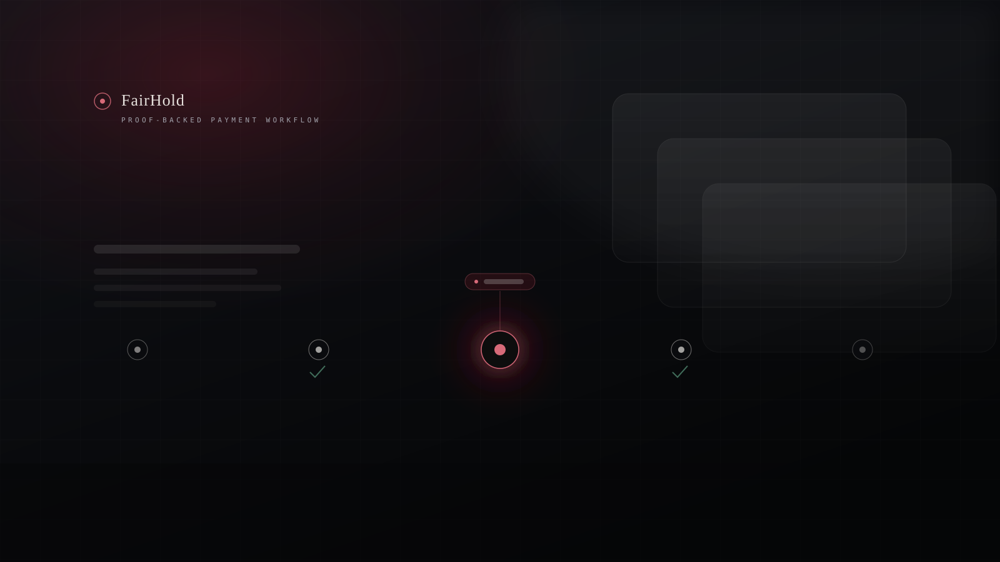
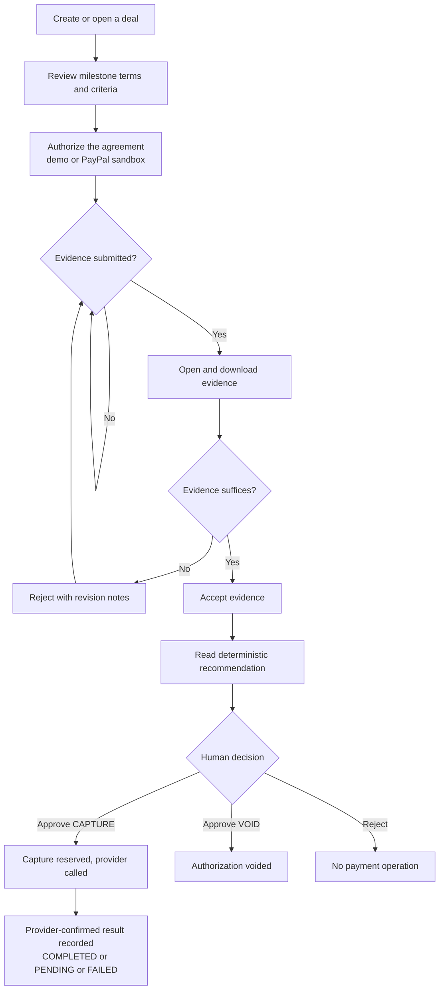
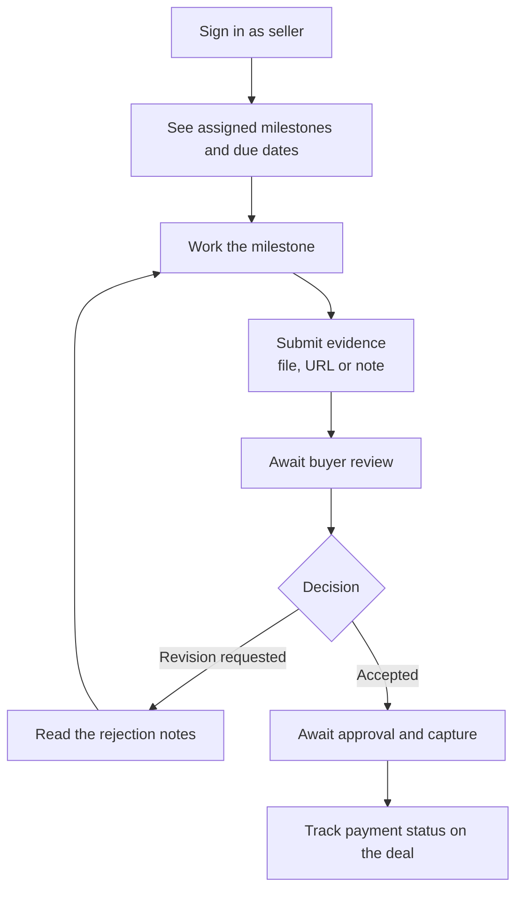
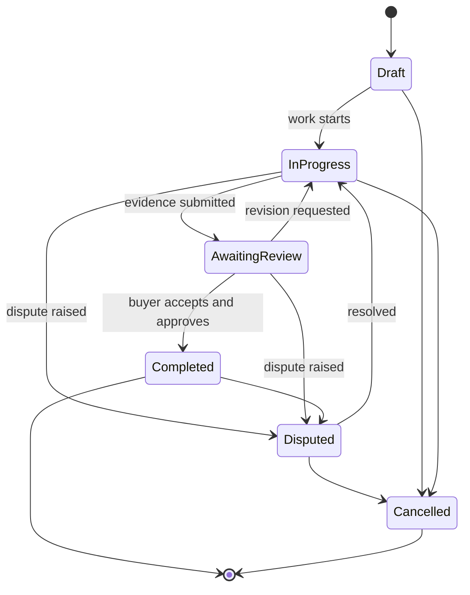
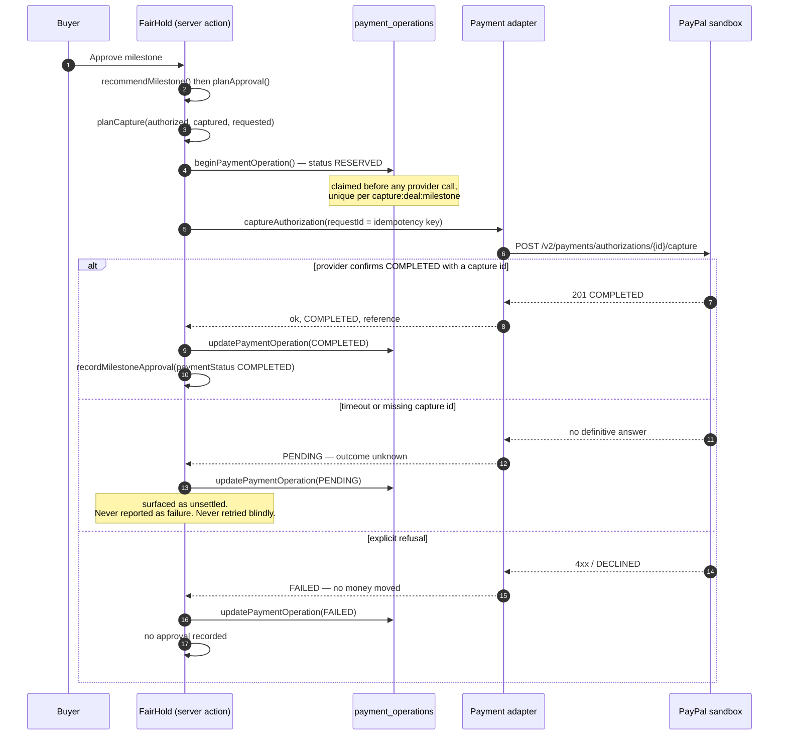
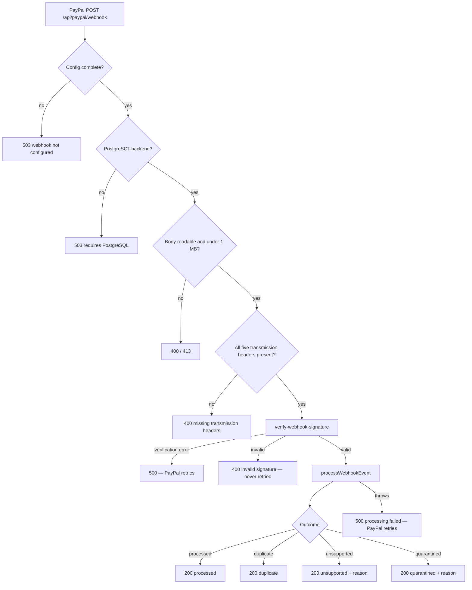
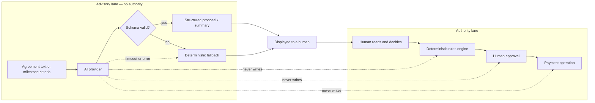
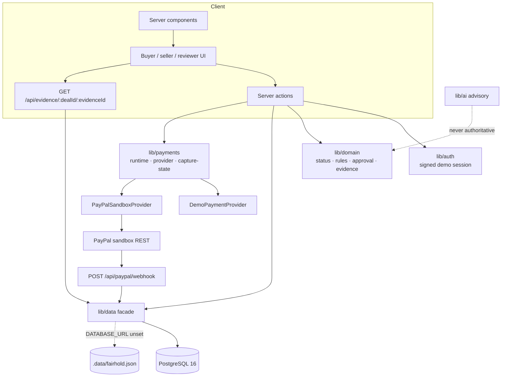
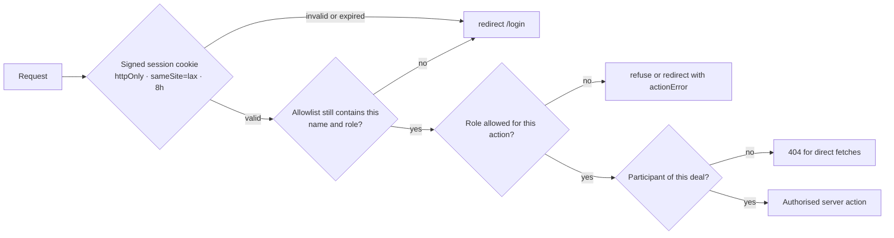

<div align="center">



# FairHold

**Milestone-based payment coordination for buyers and sellers.**

Work moves forward. Payments move with proof.

[](https://nextjs.org)
[](https://react.dev)
[](https://www.typescriptlang.org)
[](https://www.postgresql.org)
[](#quality)
[](#quality)
[](#payment-lifecycle)

</div>

---

## The philosophy

> **AI proposes. Rules decide. Humans approve. PayPal executes. The audit trail records everything.**

Every design decision in FairHold follows that ordering. The language model can suggest a milestone breakdown or summarise submitted evidence, but it has no authority. A deterministic rules engine reads the deal state and recommends `CAPTURE`, `VOID`, `HOLD` or `DISPUTE`. A human buyer (or a reviewer explicitly granted that deal) makes the decision. Only then does the payment adapter speak to PayPal. Every step is written to an append-only audit trail.

## The problem

Freelance and small-agency work is paid against trust rather than proof. Buyers hesitate to release money before delivery; sellers hesitate to deliver before payment. The usual workarounds — invoicing after the fact, informal "50% upfront" splits, screenshot-based promises — leave both sides without a shared record of what was agreed, what evidence was submitted, who approved it and what the payment state actually is.

## The solution

FairHold makes the milestone itself the unit of coordination:

1. A **deal** is created between a buyer and a seller with an agreed total.
2. The work is split into **milestones**, each with an amount, due date and written acceptance criteria.
3. The seller **submits evidence** (file, URL or note) against a milestone.
4. The buyer **reviews** the evidence, accepts it or requests a revision.
5. A **deterministic recommendation** is computed from the deal state.
6. A **human approves** the milestone; that approval is what plans a payment operation.
7. The **payment adapter** performs the PayPal authorisation or capture and records the provider-confirmed result.
8. The **activity trail** keeps the full history, in order, including rejections and revisions.

## What FairHold is not

| Not this | Why it matters |
| --- | --- |
| **Escrow** | A PayPal authorization is a temporary hold. FairHold never calls it escrow, settlement or guaranteed protection. |
| **An AI decision-maker** | The model is advisory only. It cannot approve evidence, authorize payment or capture funds. |
| **Production identity verification** | The current build uses a signed demo session plus server-side allowlists. That is not KYC and not multi-tenant auth. |
| **A refund system** | Voiding releases an authorization hold. Refunds are intentionally not modelled. |
| **A live-money product** | The real adapter is restricted to the PayPal *sandbox*. Live credentials are refused by configuration. |

---

## Key features

- **Role-aware workspaces** — distinct buyer and seller dashboards built around the actions each role actually owns, plus per-deal reviewer grants.
- **Milestone timeline** — the signature screen: every milestone state, evidence submission, review decision, revision and payment outcome on one timeline.
- **Evidence with real validation** — extension allowlist, 3 MB cap, magic-number type sniffing, sanitised filenames, authorised download route with `nosniff`.
- **Deterministic decision engine** — pure functions produce recommendations with reason codes and a human-readable explanation.
- **Human approval gate** — approving a `HOLD` or `DISPUTE` recommendation is refused; only `CAPTURE` and `VOID` can be approved.
- **Idempotent payment operations** — reservations are claimed before the provider call, keyed by `capture:<dealId>:<milestoneId>`, so a double submit cannot double-capture.
- **Honest ambiguity handling** — a timeout is recorded as `PENDING`, never as failure, and is surfaced to the user as an unsettled outcome to reconcile.
- **Fail-closed webhooks** — signature verification, duplicate suppression and a durable inbox with sanitised quarantine reasons.
- **Audit trail** — append-only events with actor, timestamp and payload; the UI renders recorded history only.
- **Reduced-motion-safe motion system** — CSS-only reveal choreography with one owner per animated property.
- **Public guided demo** — `/demo` runs the same deterministic rules in the browser against a fixed scenario, with simulated payments, no server writes and no provider calls.
- **Exact money** — every amount is an integer number of cents; typed amounts are parsed straight to cents, so no float rounding can reach the ledger.
- **Search, filters and honest empty states** — the dashboard narrows by text or status, says how many records match, and offers a clear path when nothing matches.
- **Fee transparency** — the deal page states that no FairHold platform fee is implemented in this build and that provider merchant fees sit outside the ledger.
- **Launch video** — a 100-second HyperFrames composition (source, storyboard, captions and MP4) in [`videos/fairhold-launch/`](./videos/fairhold-launch/).

---

## Buyer workflow



## Seller workflow



## Milestone lifecycle



Deal states follow the same shape, with one deliberate exception: `Authorized` can never be set by hand. It is only entered by the payment adapter after a provider-confirmed authorization (`allowedManualDealTransitions` filters it out).

## Payment lifecycle



### Webhook and reconciliation



A webhook never substitutes for human approval. It reconciles provider-reported facts against records a human already created; anything unmatched is quarantined with a reason and stops retrying.

## AI advisory boundary



---

## Technology stack

| Layer | Choice | Why |
| --- | --- | --- |
| Framework | Next.js 16.4.3 (App Router, Turbopack, Cache Components) | Server actions keep state changes on the server; `connection()` marks dynamic reads explicitly. |
| UI | React 19.3 + Tailwind CSS 4 | CSS-first tokens, small runtime, no component library to fight. |
| Language | TypeScript 5, strict | Domain rules are shared by server, tests and UI. |
| Data | PostgreSQL 16 (`pg`) with a JSON dev store | One data facade, two interchangeable backends with identical signatures. |
| Payments | PayPal sandbox REST adapter | Same contract shape as the demo provider, so UI logic never branches on provider. |
| Tests | `node:test` + Playwright | Native runner for units and PG integration; real browser journeys for the lifecycle. |
| Motion | CSS transitions and keyframes | One owner per property, reduced-motion safe, zero animation runtime. |

## System architecture



| Path | Responsibility |
| --- | --- |
| `app/` | Routes, layouts, server actions, error/loading/not-found boundaries. |
| `components/` | Status badge, progress bar, session navigation — the shared visual vocabulary. |
| `lib/auth/` | HMAC-signed demo session token, allowlists, per-deal reviewer grants. |
| `lib/domain/` | Pure state machine, recommendation rules, approval planning, evidence validation, formatting. |
| `lib/data/` | Backend selection plus identical JSON and PostgreSQL implementations. |
| `lib/payments/` | Provider contract, adapter selection, capture planning, HTTP transport, webhook endpoint. |
| `lib/ai/` | Advisory calls with strict schema validation and deterministic fallbacks. |
| `migrations/` | Four forward-only SQL migrations, checks and indexes. |
| `tests/` | Playwright lifecycle, access-control and deal-creation journeys. |

## Database overview

Four migrations build the schema: `deals`, `milestones`, `evidence`, `milestone_approvals`, `audit_events`, `payment_orders`, `payment_authorizations`, `payment_captures`, `webhook_events` and `payment_operations`.

Notable guarantees: currency is constrained to `USD`; milestone and capture amounts must be positive; evidence must carry a note, URL or stored file; capture status is constrained to `COMPLETED | VOIDED | PENDING | FAILED`; `payment_operations` has a unique index on `(provider_name, provider_reference)` and a unique invoice index so one provider fact cannot be booked twice.

Full detail: [DATABASE.md](./DATABASE.md).

## Security model



- Sessions are HMAC-SHA256 signed and compared with `timingSafeEqual`; a missing `FAIRHOLD_SESSION_SECRET` in production is a startup error, not a silent default.
- Allowlists are re-checked on every session read, so revoking a name invalidates live cookies.
- Unauthorised evidence fetches return `404` rather than `403`, so the route does not leak whether a deal or file exists.
- Evidence download pins the sniffed content type and sends `X-Content-Type-Options: nosniff` as an attachment.
- Webhook verification errors return `5xx` (retryable) and only a definitively invalid signature returns `400`.
- Provider secrets, tokens, signatures and payloads never reach logs; the webhook path logs one sanitised line.

Full threat model: [SECURITY.md](./SECURITY.md).

---

## Getting started

### Prerequisites

- Node.js 20+ (verified on 24.13.0)
- npm
- Optional: PostgreSQL 16 (required for integration tests and for webhook processing)
- Optional: Docker (used here to run an isolated test database)

### Install and run

```bash
npm install
npm run demo:reset      # seed the JSON dev store with the demo deal
npm run dev             # http://localhost:3000
```

Open `/login` and sign in with an allowlisted demo identity. If you do not set the allowlist variables, the defaults in `.env.example` are the names to use: `Alex Buyer` (buyer), `Jamie Seller` (seller), `Morgan Reviewer` (reviewer, needs a per-deal grant).

### Environment variables

All variables are documented by name in [.env.example](./.env.example) and explained in [SETUP.md](./SETUP.md). Nothing below requires a value to be checked in.

| Variable | Required | Purpose |
| --- | --- | --- |
| `DATABASE_URL` | No (production: yes) | Switches the data facade to PostgreSQL. Unset means the JSON dev store. |
| `FAIRHOLD_SESSION_SECRET` | Yes in production | HMAC secret for the demo session cookie. |
| `FAIRHOLD_DEMO_BUYERS` / `_SELLERS` / `_REVIEWERS` | Yes for login | Comma-separated allowlists per role. |
| `FAIRHOLD_REVIEWER_DEALS` | Only for reviewers | `reviewer-name:deal-id` grants. |
| `PAYPAL_ENV` | Only for sandbox | Must be exactly `sandbox`; any other value keeps the demo adapter. |
| `PAYPAL_CLIENT_ID` / `PAYPAL_CLIENT_SECRET` | Only for sandbox | Sandbox app credentials; placeholders are rejected. |
| `PAYPAL_WEBHOOK_ID` | Only for webhooks | Webhook listener id registered on developer.paypal.com. |
| `AI_API_KEY` / `AI_MODEL` / `AI_API_URL` | No | Enables live advisory calls; otherwise deterministic fallbacks run. |
| `NEXT_PUBLIC_APP_URL` | No | Canonical URL used for links and metadata. |

### Database setup

```bash
# with DATABASE_URL set
npm run db:migrate      # apply migrations/0001..0004
npm run db:import       # optional: import an existing .data/fairhold.json
```

## Testing

```bash
npm test                # unit + integration (node:test)
npm run test:e2e        # Playwright, desktop + mobile + tablet Chromium
npm run typecheck
npm run lint
npm run build
```

- Without a test database, the PostgreSQL integration tests skip rather than fail. With `FAIRHOLD_TEST_DATABASE_URL` pointing at an isolated PostgreSQL 16 database, every test runs: 193 pass, 0 skip.
- `npx playwright test` runs the same buyer/seller journeys against a production build on desktop, mobile and tablet Chromium.
- `npm test` never touches the demo database file and never contacts PayPal. `npx playwright test` never contacts PayPal either — the provider adapter is simulated in this build.

Verified results and the exact configuration used: [TESTING.md](./TESTING.md) and [QA_REPORT.md](./QA_REPORT.md).

## Deployment

The application deploys to Vercel as a standard Next.js project. A full deployment needs `DATABASE_URL` (managed PostgreSQL), `FAIRHOLD_SESSION_SECRET` and the three demo allowlists; webhook processing additionally needs a public HTTPS endpoint and `PAYPAL_WEBHOOK_ID`.

Without `DATABASE_URL`, the JSON store lives on the local filesystem, which is read-only on serverless hosts - so writes fail there by design rather than silently pretending to persist. Details and the exact required configuration: [DEPLOYMENT.md](./DEPLOYMENT.md).

**Current state (2026-11-08):** a Vercel **preview** build is Ready with the Next.js preset and the full route set, but anonymous visitors are stopped by Vercel Deployment Protection, and it has no hosted database — so it is a protected browsing demo, not a production deployment. Production env scope is empty and no production deployment has been created. See [DEPLOYMENT.md](./DEPLOYMENT.md) and [FINAL_RELEASE_REPORT.md](./FINAL_RELEASE_REPORT.md).

## Demo

Two demos exist, and they are deliberately separate:

| Demo | Where | Payments | Persistence |
| --- | --- | --- | --- |
| Guided demo | `/demo`, no sign-in | Simulated, always labelled | Browser `localStorage` on that device only |
| Operator walkthrough | `/login` + `/dashboard`, demo identities | Simulated, always labelled | Local JSON store or PostgreSQL |

```bash
npm run demo:reset   # reset the server demo store
npm run dev
```

Then follow [DEMO_GUIDE.md](./DEMO_GUIDE.md): sign in as the seller, submit evidence, switch to the buyer, request a revision, resubmit, accept, and walk the approval through the simulated capture. Every simulated action is labelled as simulated in the UI.

For a non-interactive walkthrough, [`videos/fairhold-launch/renders/fairhold-launch.mp4`](./videos/fairhold-launch/renders) tells the same story in 100 seconds; the 30-second cut is next to it.

## Documentation

| Document | Contents |
| --- | --- |
| [ARCHITECTURE.md](./ARCHITECTURE.md) | Layers, request flows, decisions and trade-offs. |
| [DATABASE.md](./DATABASE.md) | Tables, constraints, indexes, migrations and transactions. |
| [API_REFERENCE.md](./API_REFERENCE.md) | The two HTTP routes and every server action. |
| [PAYMENT_FLOW.md](./PAYMENT_FLOW.md) | Authorization, capture, void, idempotency, ambiguity and webhooks. |
| [AI_DESIGN.md](./AI_DESIGN.md) | Prompts, schema validation, fallbacks and the authority boundary. |
| [SECURITY.md](./SECURITY.md) | Threat model, controls and known limitations. |
| [SETUP.md](./SETUP.md) | Prerequisites, environment, migrations, troubleshooting. |
| [TESTING.md](./TESTING.md) | Test architecture, commands and verified results. |
| [DEPLOYMENT.md](./DEPLOYMENT.md) | Vercel configuration and production requirements. |
| [USER_GUIDE.md](./USER_GUIDE.md) | Buyer, seller and reviewer instructions. |
| [DEMO_GUIDE.md](./DEMO_GUIDE.md) | A repeatable five-minute demonstration script. |
| [DEMO_SCRIPT_3MIN.md](./DEMO_SCRIPT_3MIN.md) | Spoken three-minute hackathon demo, with timing beats and what not to claim. |
| [RELEASE_CHECKLIST.md](./RELEASE_CHECKLIST.md) | Release acceptance checklist. |
| [CHANGELOG.md](./CHANGELOG.md) | Implementation history. |
| [QA_REPORT.md](./QA_REPORT.md) | Latest verification evidence. |
| [HANDOFF.md](./HANDOFF.md) | Current state, blockers and next actions. |
| [FINAL_RELEASE_REPORT.md](./FINAL_RELEASE_REPORT.md) | The final evidence-based release report and verdicts. |
| [FINAL_REMAINING_WORK.md](./FINAL_REMAINING_WORK.md) | Gap matrix: every remaining item, its priority and its blocker. |
| [videos/fairhold-launch/](./videos/fairhold-launch/) | Launch video source, storyboard, captions and renders. |

## Limitations

- Demo authentication only — signed names, not verified identities.
- PayPal **sandbox** only; live credentials are refused by design. Live sandbox verification is not claimed (no credentials were configured in this environment).
- No refunds, no partial refunds, no dispute arbitration, no multi-currency (USD only).
- No email or push notifications; the activity trail is the record.
- The JSON store is single-process and not safe for concurrent multi-user writes.
- Live AI provider calls are optional and unverified here; the deterministic fallback is what the tests exercise.
- Ambiguous payment outcomes are surfaced and preserved, but automatic reconciliation is a manual operator step.

## Future improvements

- Production identity (OIDC or SSO) replacing the demo session.
- Automated reconciliation job for `PENDING` captures against provider reports.
- Refund modelling and partial-capture accounting across currencies.
- Notification delivery on review and payment transitions.
- Read replicas and row-level access policies per tenant.

---

<div align="center">

**FairHold** — work moves forward, payments move with proof.

<a href="./public/fairhold-hero.svg">Brand asset</a> · <a href="./SECURITY.md">Security</a> · <a href="./DEMO_GUIDE.md">Demo script</a>

</div>
