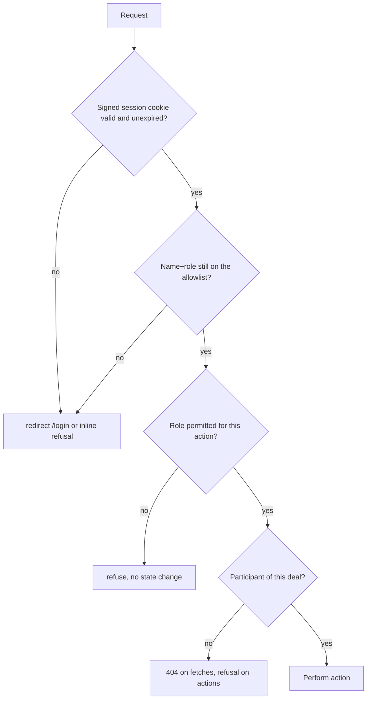

# Security

This document describes what the current build protects, how, and what it explicitly does not protect. It is a description of controls that exist in code, not a claim of certification.

## Authentication model

| Aspect | Implementation |
| --- | --- |
| Identity | A display name plus a role (`buyer`, `seller`, `reviewer`) submitted on the demo login form. |
| Authorisation of identity | Server-side allowlists: `FAIRHOLD_DEMO_BUYERS`, `FAIRHOLD_DEMO_SELLERS`, `FAIRHOLD_DEMO_REVIEWERS` (trimmed, case-insensitive). |
| Session | `fairhold_session` cookie: `base64url(JSON{name, role, exp}) + "." + HMAC-SHA256` using `FAIRHOLD_SESSION_SECRET`. |
| Lifetime | 8 hours, both in the token and the cookie `maxAge`. |
| Cookie flags | `httpOnly`, `sameSite=lax`, `path=/`, `secure` when `NODE_ENV=production`. |
| Signature check | Length check then `timingSafeEqual`. |
| Revocation | The allowlist is re-checked on every session read, so removing a name invalidates live cookies. |
| Production secret | Missing `FAIRHOLD_SESSION_SECRET` in production throws at startup — no development default is used. |

**This is demo authentication.** It does not verify that a person is who they claim to be. There is no password, no OAuth, no email verification, no MFA, no account creation and no tenant isolation. Presenting it as production identity verification would be false.

## Authorization model

| Role | May |
| --- | --- |
| Buyer | Create deals, add/update milestones, authorize, review evidence, record approvals, change deal status. |
| Seller | Create deals, add/update milestones, submit evidence, change milestone and deal status. |
| Reviewer | Everything a participant may do **for deals explicitly granted** to them, and nothing on any other deal. |

Reviewer grants are `reviewer-name:deal-id` entries in `FAIRHOLD_REVIEWER_DEALS`, parsed on the **last** colon so names containing a colon are still matched correctly. A reviewer is never granted access by default.

Participantship is derived from the deal itself: a buyer session matches `deal.clientName`, a seller session matches `deal.freelancerName`, compared case-insensitively. There is no separate membership table, which means renaming a person in the session does not silently grant access to an unrelated deal.

## Controls in place

### Input validation

- Every mutation re-parses amounts from strings into integer cents; floats are never trusted.
- Currency is pinned to `USD` in validation and in the database `CHECK`.
- Dates are validated structurally (`YYYY-MM-DD`, round-trip check).
- Length limits on titles, names, agreement, descriptions, acceptance criteria, notes and URLs.
- Uploads: extension allowlist (`png jpg jpeg pdf txt md csv`), 3 MB cap, magic-number sniffing for PNG/JPEG/PDF, conservative text heuristic otherwise, filename sanitisation (`sanitizeFileName` strips paths, leading dots, unsafe characters, caps at 100 characters).
- URLs: `http`/`https` only, parsed with `URL`, 500-character cap.

### Injection and output safety

- All SQL goes through parameterised `pg` queries; no string concatenation of user values.
- React escapes rendered text; model output is treated as plain strings of bounded length, never as HTML.
- Evidence download sets the sniffed content type and `X-Content-Type-Options: nosniff` on an attachment response, so a mislabelled file cannot be executed in the origin.
- Response bodies for unauthorised evidence access are identical (`404 Not found`), so the route does not disclose whether a deal or file exists.

### CSRF

Mutations use Next.js server actions, which are same-origin and do not accept cross-origin form posts from other sites. The session cookie is `sameSite=lax`, so it is not sent on cross-site `POST`. There is no separately exposed cookie-authenticated REST mutation endpoint.

### Payment safety

- A client cannot submit a provider reference, recommendation, payment status or capture amount.
- The recommendation is recomputed from stored state at approval time.
- Approval is refused for `HOLD` and `DISPUTE`.
- The capture is reserved and arithmetic-checked before any provider call.
- A timeout is `PENDING`, never failure and never success.
- The provider reference and the reservation are unique, so a fact cannot be booked twice.

### Webhook security

- All five PayPal transmission headers required.
- Signature verified against the configured `PAYPAL_WEBHOOK_ID` via PayPal's verify endpoint; only `SUCCESS` is accepted.
- A verification *error* returns `5xx` so PayPal retries; only a definitive non-success returns `400`.
- Duplicate event ids are recorded and returned as `duplicate`.
- Events that cannot be reconciled are quarantined with a sanitised reason and answered `2xx`.
- Logging is a single line with event id, type, outcome, status and a reason for quarantined/unsupported events. Headers, signatures, payloads and secrets are never logged.

### Secret handling

- Secrets are read from the environment only. No secret is committed.
- `.env*` files are gitignored, and the repository's safety configuration blocks reading them through tooling.
- Placeholder detection (`/^your_/i`) prevents an unfilled `.env.example` value from activating the real PayPal adapter.
- The demo session secret has a development-only default and throws in production.

## Known limitations

| Limitation | Impact | Mitigation / next step |
| --- | --- | --- |
| Demo identity, no credential | Anyone who can reach the app and knows an allowlisted name can act as that role. | Deploy demo builds to restricted preview URLs; replace with real identity before any real use. |
| No rate limiting | Login attempts and action posts are not throttled. | Add edge rate limiting before exposing publicly. |
| No CSP / security headers | No `Content-Security-Policy`, HSTS or referral policy is configured. | Add a headers block in `next.config.ts`. |
| In-process JSON write lock | Single-instance only; concurrent multi-instance writes are unsafe. | Use the PostgreSQL backend. |
| No automatic reconciliation | `PENDING` operations stay unresolved until an operator checks the provider. | Scheduled reconciliation job. |
| Evidence stored on local disk | Not replicated; a database backup alone is incomplete. | Object storage with signed URLs. |
| No audit tamper-evidence | `audit_events` rows are append-only in the application, not cryptographically chained. | Hash chain or append-only external sink. |
| No dependency scanning in CI | `npm audit` is not wired into a pipeline. | Add it to CI. |

## Dependency posture

Runtime dependencies are deliberately minimal: `next`, `react`, `react-dom` and `pg`. Development dependencies are `typescript`, `eslint`, `eslint-config-next`, `tailwindcss`, `@tailwindcss/turbopack`, `@playwright/test` and the type packages. Fewer dependencies means a smaller supply-chain surface; no payment, auth or validation library is used.

## Reporting

This is a hackathon build with no production deployment of record. Treat every finding as a design note: the honest statement is that FairHold demonstrates the *structure* of payment safety — reservations, idempotency, human approval, fail-closed webhooks — while relying on demo identity and a sandbox-only payment adapter.
